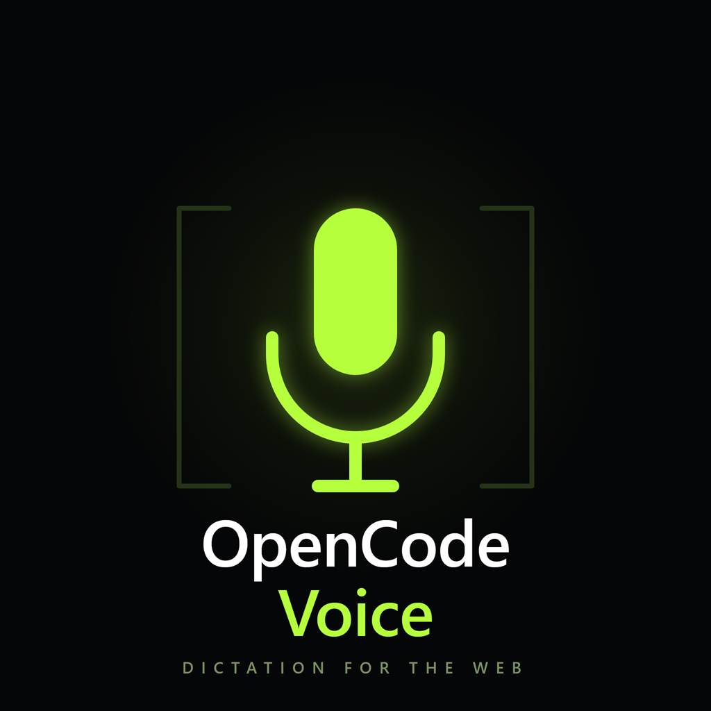

# 🚀 OpenCodeVoice



<!-- tagline-en:start -->
> Voice dictation for OpenCode 2 web: tap the microphone, speak, and send. Whisper via Groq or any OpenAI-compatible speech-to-text endpoint, optional LLM cleanup, RU/EN interface.
<!-- tagline-en:end -->

<!-- tagline-ru:start -->
> Голосовой ввод для OpenCode 2 в браузере: нажмите микрофон, говорите и отправляйте. Whisper через Groq или любой OpenAI-совместимый сервис распознавания, необязательная очистка текста моделью и интерфейс на русском и английском.
<!-- tagline-ru:end -->

[English](#-english) | [Русский](#-русский)

## 🇺🇸 English

<!-- summary-en:start -->
### ❓ Why

Typing long prompts on a phone is slow and awkward. OpenCodeVoice adds a microphone to the OpenCode composer and to question prompts, so a prompt can be dictated in a few seconds and sent without touching the keyboard.

### ✅ What

A small userscript that records audio in the browser, sends it to a speech-to-text service, optionally cleans the transcript with an LLM, inserts the result into the active OpenCode field, and sends it when auto-submit is enabled. It also protects the conversation: if you switch chats while a recording is being processed, the text is saved instead of being pasted into the wrong session.
<!-- summary-en:end -->

<!-- features-en:start -->
### Features

| Feature | Description |
| --- | --- |
| 🎙 Mic in the composer | One button next to the OpenCode input; the native controls are left untouched. |
| 💬 Mic in questions | Dictate answers into OpenCode question prompts, including custom options. |
| ⚡ Tap-to-talk | Tap to start, tap to stop. Auto-submit sends the finished text by default. |
| 🗣 Whisper preset | Built-in Groq preset for `whisper-large-v3-turbo`; only an API key is required. |
| 🔌 Custom STT | Any OpenAI-compatible endpoint: OpenAI, a proxy, or a self-hosted server. |
| ✨ Cleanup | Optional LLM pass that removes filler words and fixes punctuation. Ollama Cloud, Ollama Local, or a custom OpenAI-compatible endpoint. |
| ✍️ Editable prompt | The cleanup prompt can be changed at any time; a custom prompt is never overwritten. |
| 🛡 Session guard | If you switch chats during recognition, the text is not inserted or sent into the new chat. It stays saved for later. |
| 📝 Draft guard | If you edit the draft while recognition is running, the text is inserted but not auto-sent, so nothing is lost. |
| ♻️ Recovery | Failed recordings and recognized text survive a page reload; retry, insert, or send them later. |
| 🌍 RU / EN | The interface and the default prompts are available in Russian and English. |
| ⌨️ Hotkeys | `Ctrl+Space` starts and stops dictation, `Esc` cancels it. |
| 📱 Responsive | Works on desktop and mobile, including Firefox for Android. |
<!-- features-en:end -->

### 🎛 Settings

Open the panel with the gear button next to the microphone.

- **STT** — speech-to-text provider, endpoint, API key, model, and recognition language.
- **Cleanup** — optional LLM cleanup, provider, endpoint, key, model, and the cleanup prompt.
- **Behavior** — interface language, auto-submit for the composer and for questions, fallback to raw text, recording limit, and failed-audio saving.
- **Diagnostics** — selector status for the current OpenCode page and saved failures.

### 🔒 Privacy

- Audio is sent only to the configured speech-to-text provider.
- The transcript is sent only to the configured LLM provider, and only when cleanup is enabled.
- API keys are stored in userscript storage and are not encrypted at rest.
- No analytics, telemetry, or third-party tracking.

### 🩺 Troubleshooting

- `401` — the API key is missing or invalid.
- `403` / `451` — the provider blocks the region. Use a custom endpoint with a proxy or another provider.
- No microphone — browsers allow recording only in a secure context: HTTPS, `localhost`, or `127.0.0.1`. Plain HTTP over a LAN address will not work.

### ⚡ Quick Start

1. Install [Tampermonkey](https://www.tampermonkey.net/) or [Violentmonkey](https://violentmonkey.github.io/).
2. **[Install OpenCodeVoice](https://raw.githubusercontent.com/slaid098/OpenCodeVoice/dist/opencode-voice-dictation.user.js)**.
3. Open the OpenCode 2 web interface and click the gear button next to the microphone.
4. Paste a Groq API key — a free one is available at [console.groq.com/keys](https://console.groq.com/keys) — or choose a custom endpoint and fill in its URL and model.
5. Save, tap the microphone, speak, and tap it again.

### 🛠 Development

```bash
npm install
npm run lint
npm run typecheck
npm run test
npm run build
```

## 🇷🇺 Русский

<!-- summary-ru:start -->
### ❓ Зачем

Набирать длинные запросы с телефона медленно и неудобно. OpenCodeVoice добавляет микрофон в поле ввода OpenCode и в вопросы, поэтому запрос можно надиктовать за несколько секунд и отправить, не касаясь клавиатуры.

### ✅ Что

Небольшой userscript: записывает звук в браузере, отправляет его в сервис распознавания речи, при желании очищает текст моделью, вставляет результат в активное поле OpenCode и отправляет его, если включена автоотправка. Скрипт также защищает диалог: если во время распознавания переключиться на другой чат, текст сохранится, а не вставится в чужую сессию.
<!-- summary-ru:end -->

<!-- features-ru:start -->
### Фичи

| Фича | Описание |
| --- | --- |
| 🎙 Микрофон в композере | Одна кнопка рядом с полем ввода OpenCode; родные кнопки не меняются. |
| 💬 Микрофон в вопросах | Диктовка ответов в вопросах OpenCode, включая вариант со своим ответом. |
| ⚡ Нажал — говоришь | Нажатие запускает запись, повторное — останавливает. Автоотправка по умолчанию включена. |
| 🗣 Пресет Whisper | Встроенный Groq-пресет для `whisper-large-v3-turbo`; нужен только API-ключ. |
| 🔌 Свой STT | Любой OpenAI-совместимый адрес: OpenAI, прокси или собственный сервер. |
| ✨ Очистка | Необязательная обработка текста моделью: убирает слова-паразиты и расставляет знаки. Ollama Cloud, Ollama Local или свой OpenAI-совместимый адрес. |
| ✍️ Свой промпт | Промпт очистки можно изменить в любой момент; пользовательский промпт не перезаписывается. |
| 🛡 Защита сессии | Если во время распознавания переключить чат, текст не вставится и не отправится в новый чат. Он сохранится для ручной вставки. |
| 📝 Защита черновика | Если во время распознавания изменить черновик, текст вставится, но не отправится автоматически — ничего не потеряется. |
| ♻️ Восстановление | Неудачные записи и распознанный текст переживают перезагрузку страницы: их можно повторить, вставить или отправить позже. |
| 🌍 RU / EN | Интерфейс и стандартные промпты доступны на русском и английском. |
| ⌨️ Горячие клавиши | `Ctrl+Space` запускает и останавливает диктовку, `Esc` отменяет её. |
| 📱 Адаптивность | Работает на компьютере и телефоне, включая Firefox для Android. |
<!-- features-ru:end -->

### 🎛 Настройки

Панель открывается кнопкой-шестерёнкой рядом с микрофоном.

- **STT** — сервис распознавания, адрес, API-ключ, модель и язык распознавания.
- **Очистка** — необязательная обработка текста моделью: провайдер, адрес, ключ, модель и промпт очистки.
- **Поведение** — язык интерфейса, автоотправка в композер и в ответы на вопросы, откат к сырому тексту, лимит записи и сохранение неудачного аудио.
- **Диагностика** — состояние селекторов на текущей странице OpenCode и сохранённые ошибки.

### 🔒 Приватность

- Аудио отправляется только в выбранный сервис распознавания речи.
- Распознанный текст отправляется только в выбранный LLM-сервис и только при включённой очистке.
- API-ключи хранятся в хранилище userscript и не шифруются.
- Никакой аналитики, телеметрии и стороннего трекинга.

### 🩺 Если что-то не работает

- `401` — API-ключ не указан или неверен.
- `403` / `451` — провайдер блокирует регион. Используйте свой адрес через прокси или другой сервис.
- Нет микрофона — браузеры разрешают запись только в защищённом контексте: HTTPS, `localhost` или `127.0.0.1`. Обычный HTTP по адресу в локальной сети не подойдёт.

### ⚡ Быстрый старт

1. Установите [Tampermonkey](https://www.tampermonkey.net/) или [Violentmonkey](https://violentmonkey.github.io/).
2. **[Установите OpenCodeVoice](https://raw.githubusercontent.com/slaid098/OpenCodeVoice/dist/opencode-voice-dictation.user.js)**.
3. Откройте веб-интерфейс OpenCode 2 и нажмите шестерёнку рядом с микрофоном.
4. Вставьте API-ключ Groq — бесплатный можно получить на [console.groq.com/keys](https://console.groq.com/keys) — или выберите свой адрес и укажите его URL и модель.
5. Сохраните, нажмите микрофон, говорите и нажмите его снова.

### 🛠 Разработка

```bash
npm install
npm run lint
npm run typecheck
npm run test
npm run build
```

---

## 💬 Support and contacts / Поддержка и контакты

👉 **[slaid098.dev/contacts](https://slaid098.dev/contacts)**
